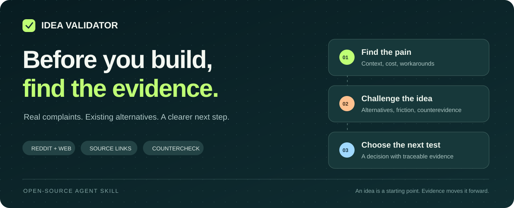
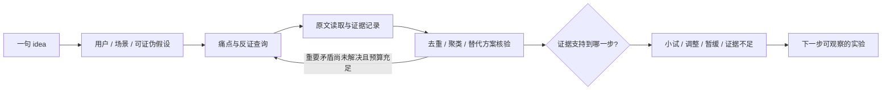

<p align="center">
  
</p>

<p align="center">
  <a href="https://github.com/ziho7/idea-validator/releases"></a>
  <a href="https://github.com/ziho7/idea-validator/actions/workflows/validate.yml"></a>
  <a href="LICENSE"></a>
  
</p>

<h1 align="center">Idea Validator</h1>
<p align="center"><strong>你的 idea，值得花接下来的一个月吗？</strong><br>说出想法，让 AI 带着问题走进真实讨论，再带着证据回来。</p>
<p align="center">中文 · <a href="README.en.md">English</a> · <a href="#快速开始">快速开始</a> · <a href="examples/video-feedback/report.zh-CN.md">真实研究示例</a> · <a href="#它是怎么实现的">实现细节</a></p>

---

你想做一个产品。有人说“挺好的”，有人说“早就有人做了”。真正需要知道的是：

**谁正在受这个问题困扰？他们为此做过什么？现有工具为什么还不够？下一步该验证什么？**

Idea Validator 是一个开源 Agent Skill。它把一句产品想法变成一轮有边界、可追溯的需求研究：搜索 Reddit 等相关平台，阅读真实用户的经历、抱怨、替代办法与反对意见，最后给出行动建议。

> **真实抱怨 → 行为证据 → 现有替代 → 反证检查 → 下一步实验**
>
> 问题存在、方案有效、愿意付费，是三个需要分别回答的问题。

## 你会拿到什么

- **一页决策摘要**：值得小试、调整方向、暂缓投入，或证据不足。
- **可回溯的证据表**：原文链接、日期、短摘录、用户场景、访问状态和局限。
- **痛点与人群分层**：谁在什么情况下遇到问题，已经采取了什么行动。
- **替代方案与反证**：现有产品、手工流程、满意用户，以及原想法可能失效的原因。
- **下一步实验**：招募条件、真实任务、观察行为和预先建议的决策门槛。
- **可选 JSON 证据台账**：用于复查、比较后续研究，附 Python 结构校验器。

不会凭几条热帖给你“87 分的创业机会”，也不会把搜索不到解释成需求不存在。

## 快速开始

### 1. 安装到 Codex

在 Codex 中发送：

```text
请使用 $skill-installer，从 https://github.com/ziho7/idea-validator
安装仓库根目录的 idea-validator 技能，使用 v0.1.0 版本。
```

或手动安装（macOS / Linux，需要 Git；目标目录必须尚不存在）：

```bash
mkdir -p "$HOME/.agents/skills"
git clone --branch v0.1.0 --depth 1 \
  https://github.com/ziho7/idea-validator.git \
  "$HOME/.agents/skills/idea-validator"
```

Codex 的用户级技能目录和自动发现方式见 [OpenAI 官方文档](https://learn.chatgpt.com/docs/build-skills)。若技能未出现，重新启动 Codex。也可以将仓库放进项目的 `.agents/skills/idea-validator/`，只在该项目使用；避免同时安装多个同名副本。

### 2. 说出你的想法

```text
使用 $idea-validator 验证这个想法：
我想给自由职业剪辑师做一个工具，把客户散落在邮件、聊天和
审片工具里的修改意见，整理成带来源和时间码的任务列表。
先看英语市场，重点找真实抱怨、现有替代方案和付费信号。
```

也可以只说一句：

```text
用 $idea-validator 帮我看看：给小型健身工作室做一个会员流失预警工具，有没有真实需求？
```

Agent 会说明假设并开始；只有缺失信息会明显改变搜索方向时才追问。

### 3. 选择研究力度（可选）

| 模式 | 搜索查询上限 | 原文打开上限 | 适用场景 |
| --- | ---: | ---: | --- |
| Quick | 12 | 15 | 先判断是否值得继续看 |
| Standard，默认 | 24 | 30 | 做一次有依据的方向判断 |
| Deep | 40 | 50 | 多个人群或竞争假设 |

这是工作量上限，包含失败尝试；不是必须凑齐的证据数，也不保证固定耗时。可以直接指定“只用我给的材料”或自定义预算。

**运行要求：**能读取 Skill 的 Agent，以及联网搜索和原文读取能力。Skill 本身不包含平台 API、抓取服务或账号凭据；实际覆盖取决于宿主工具和页面权限。Python 3.10+ 仅用于可选校验器，没有第三方 Python 依赖。没有联网工具时，它会说明限制并处理已有资料，不伪装完成调研。

## 真实案例：客户修改意见整理工具

我们在 2026-10-10 做了一次有限预算的公开网络研究，保留了 [完整报告](examples/video-feedback/report.zh-CN.md) 和 [结构化证据](examples/video-feedback/evidence.json)。这是开发期间的工作示例，不是产品成功率测试。

**输入：**为自由职业剪辑师整理跨渠道反馈，生成带时间码的修改任务。

**得到的判断：建议缩小方向后做人工试验。**

| 发现 | 对想法的影响 |
| --- | --- |
| 用户讨论反馈散在 Drive、WhatsApp、邮件等渠道 | 痛点有公开信号，但样本不全是独立剪辑师。[原帖](https://www.reddit.com/r/videography/comments/1sybl2j/how_are_you_handling_client_feedback_on_video/) |
| 有剪辑师认为客户不愿使用现有审片流程 | 需要验证客户行为；再增加一个入口可能有同样障碍。[原帖](https://www.reddit.com/r/editors/comments/1rw7un5/client_not_using_frame_io_correctly_frustrating/) |
| Frame.io 文档已有时间码评论、完成状态和导出 | 基础功能的差异化不足；需要继续验证跨渠道归集的价值。[评论文档](https://help.frame.io/en/articles/9105251-commenting-on-your-media)、[面板文档](https://help.frame.io/en/articles/9105278-comments-panel-overview) |
| 尚无对拟议独立工具的实际购买证据 | 不能宣布商业需求已验证；先观察重复使用，再测试真实付款。 |

下一步建议是让符合条件的剪辑师用真实项目试一次人工归集，对照现有流程观察耗时、错误和重复使用。没有明确时间定位的信息保留为“待确认”，不能生成假时间码。

示例也保留了旧资料、推广来源、身份不明和无法核实的日期。**7 个来源页面，不等于 7 位潜在付费客户。**

## 信息源地图

根据目标用户选平台，不机械地每次搜遍所有网站。以下是研究候选来源，**不是已经接入的连接器清单**。

| 来源 | 主要寻找什么 | 如何避免误读 |
| --- | --- | --- |
| [Reddit](https://www.reddit.com/) | 完整经历、求助、临时解决办法、替代产品 | 检查上下文、推广身份、同帖重复 |
| [Hacker News](https://news.ycombinator.com/) | 技术用户和创业者的工作流程 | 不外推到所有消费者 |
| [GitHub Issues](https://github.com/) / [Stack Exchange](https://stackexchange.com/) | 可复现问题、功能缺口、解决过程 | 核实版本、关闭原因和已有答案 |
| [G2](https://www.g2.com/) / [Capterra](https://www.capterra.com/) / [Trustpilot](https://www.trustpilot.com/) | 实际使用不满、迁移和弃用原因 | 区分激励评价、身份不明与真实经历 |
| [App Store](https://apps.apple.com/) / [Google Play](https://play.google.com/store/apps) | 具体功能问题、版本反馈 | 注意地区、版本和评分偏差 |
| [V2EX](https://www.v2ex.com/) / [知乎](https://www.zhihu.com/) / [小红书](https://www.xiaohongshu.com/) | 中文表达、本地场景、消费和使用经验 | 标明登录限制与商业推广 |
| [X](https://x.com/) / 公开垂直社区 | 新出现的问题、求推荐、切换意图 | 去除转发重复，补齐上下文 |
| 产品官网 / 帮助中心 / 更新日志 | 已有功能、套餐边界、旧问题是否修复 | 厂商功能说明不代表用户需求成立 |

无法读取原文时记为线索；遇到访问限制换来源并披露。不会自动加入私密社区，也不绕过访问控制。

## 它是怎么实现的

这是一套可检查的研究指令、参考规则和本地校验代码。联网检索由宿主 Agent 的工具执行，判断由模型依据证据完成。



### ① 搜用户的处境，而不只搜产品名

“AI 整理客户反馈”会被展开为“修改意见漏掉”“邮件返工”“客户不留时间码”“手动复制到表格”等表达，同时检索“现有工具够用”“不值得付费”“问题已修复”。完整查询策略见 [search-playbook.md](references/search-playbook.md)。

### ② 让每个判断有出处

证据以 `E1 / E2 / ...` 编号，与 `H1 / H2 / ...` 假设关联。记录原始链接、时间、读取状态、短摘录、行为、付费信号和独立性分组。未知值保留 `null`，不同来源里的同一事件不重复计数。[字段与判断规则](references/evidence-rules.md)

### ③ 把反证放进主报告

功能已有、用户满意、付费意愿弱、换工具成本高，都可能改变建议。对“痛点真实”“方案匹配”“实际支付”分别判断；用带理由的高/中/低置信度，不输出伪精确总分。[报告模板](references/report-template.md)

### ④ 用停止规则控制研究成本

两轮扩展搜索没有新的重要痛点、反例或独立经历，或达到预算上限，就结束并披露原因。预算用完、页面打不开和证据饱和是不同状态。

### ⑤ 用代码检查可检查的部分

```bash
python3 scripts/validate_evidence.py examples/video-feedback/evidence.json
python3 -m unittest discover -s tests -v
```

校验器检查必填字段、类型、日期、编号、假设引用、未核实线索标记和付费行为字段；重复 URL、缺少反证查询会产生提醒。它不会联网验证引文，也无法自动证明研究结论正确。

退出码：`0` 结构有效（可有提醒），`1` 数据不合规，`2` 文件或 JSON 无法读取。

## 仓库结构

```text
idea-validator/
├── SKILL.md                         # Agent 执行入口与研究流程
├── agents/openai.yaml               # Codex 展示与调用信息
├── references/
│   ├── search-playbook.md           # 查询、信息源、访问与日期规则
│   ├── evidence-rules.md            # 证据判断与 JSON 数据约定
│   └── report-template.md           # 决策报告与实验设计
├── scripts/validate_evidence.py     # 无第三方依赖的台账校验器
├── examples/video-feedback/         # 真实检索案例与证据
├── tests/                           # 校验器测试；合成资料明确标记
├── docs/                            # README 视觉与质量检查说明
└── .github/workflows/validate.yml   # 自动化校验
```

核心 Skill 按需读取参考文件；README、案例和测试不是每次调用都加载，避免无关上下文占用。

## 边界与常见问题

**它能证明 idea 一定赚钱吗？** 不能。它帮助决定下一次验证，把公开信号和未验证假设分开。真实使用效果、付费和留存需要实验。

**一定要找到多少条抱怨才算有需求？** 没有统一条数。来源质量、场景匹配、独立性和行为比热度更有意义。

**会自动发帖、私信或联系客户吗？** 默认只读研究和设计实验。对外沟通和实际实验需要你的授权。

**支持其他 Agent 吗？** 核心是标准 `SKILL.md` 加参考文件，可以迁移到支持该格式的宿主；v0.1.0 的安装说明面向 Codex，其他宿主的发现方式和工具映射未做兼容性认证。

**测试了什么？** 校验器有单元测试、CLI 退出码测试，CI 同时检查真实示例台账。技能另做有限离线行为检查，范围见 [质量检查记录](docs/quality.md)。这些检查不代表已做大规模准确率评测。

## 参与改进

欢迎提交真实失败案例：想法与目标人群、已执行查询、来源链接、哪个结论缺乏支持，以及你认为应如何调整。请先移除私人信息。优先改进证据质量、来源覆盖与决策清晰度；不要用增加固定搜索条数替代判断。

代码修改运行测试；研究示例修改保留检索日期、原始链接与局限说明。

## License

[MIT](LICENSE)。仓库中的代码、原创说明和设计按 MIT 发布；外部帖文的短摘录及第三方商标仍归各自权利人所有，来源链接不表示合作或背书。

---

<p align="center"><strong>把“我觉得有人需要”，推进到“我知道下一步该验证什么”。</strong><br>如果这能帮你少走一次弯路，欢迎 Star，也欢迎带着反例回来。</p>
